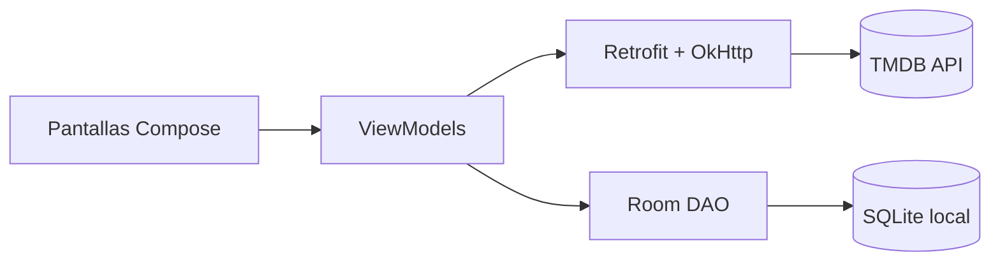

# Peliculator

Aplicación Android para explorar **películas, series y reparto**, consultar sus detalles y guardar títulos como favoritos o en la lista de seguimiento. La información y las imágenes se obtienen de [The Movie Database (TMDB)](https://www.themoviedb.org/).

Proyecto académico del ciclo de **Desarrollo de Aplicaciones Multiplataforma (DAM)**, desarrollado con Kotlin y Jetpack Compose.


## Funcionalidades

### Películas
- Carruseles de **En cartelera**, **Próximamente** y **Mejor valoradas**.
- Carga incremental: al llegar al final de un carrusel se solicita la siguiente página a TMDB.
- Buscador con sugerencias desplegables (a partir de 3 caracteres y con *debounce* de 300 ms).
- Navegación a la ficha completa de cada película.

### Series
- Carruseles de **En emisión**, **Populares** y **Mejor valoradas**.
- Misma paginación incremental y buscador con sugerencias que en películas.
- Navegación a la ficha completa de cada serie.

### Fichas de detalle
- **Película**: póster, título, sinopsis, géneros, fecha de estreno, nota media, duración, reparto y películas similares.
- **Serie**: póster, título, sinopsis, géneros, fecha del primer episodio, nota media, número de temporadas y episodios, reparto y series similares.
- **Actor/actriz**: fotografía, nombre, biografía y filmografía combinada de cine y televisión; cada crédito enlaza con su ficha correspondiente.

### Favoritos y lista de seguimiento
- Botón de corazón para marcar o desmarcar un título como favorito.
- Botón `+` / `✓` para añadir o quitar de la watchlist.
- Pantalla **Favoritos** con secciones separadas para películas, series y watchlist.
- Persistencia local con **Room**, por lo que se conservan al cerrar la aplicación y no requieren conexión.

### Interfaz
- Splash animado con las letras de *peliculeitor* y transición automática a la pantalla principal.
- Material 3 con **color dinámico** en Android 12 o superior y adaptación a modo claro/oscuro.
- Barra de navegación inferior con las secciones Películas, Series y Favoritos.
- Recursos de texto en **español** e **inglés**.
- Imágenes cargadas de forma asíncrona con Coil.

## Stack tecnológico

| Área | Tecnología |
|---|---|
| Lenguaje | Kotlin 2.0.21 |
| UI | Jetpack Compose + Material 3 |
| Navegación | Navigation Compose |
| Presentación | ViewModel + Compose State / StateFlow |
| Red | Retrofit 2.11 + Gson + OkHttp |
| Imágenes | Coil Compose 2.6 |
| Persistencia | Room 2.6 (KAPT) |
| Concurrencia | Kotlin Coroutines |
| API | TMDB API v3 |
| Build | Gradle 8.13 (Kotlin DSL), AGP 8.13 |
| SDK | minSdk 24, targetSdk/compileSdk 36 |

## Arquitectura

La app sigue un enfoque **MVVM ligero**: cada pantalla Compose observa el estado de su ViewModel, y el ViewModel accede directamente a la API mediante Retrofit o a la base de datos mediante Room. No hay una capa `repository` intermedia.



- **Una sola Activity** (`MainActivity`) con navegación por rutas de Navigation Compose.
- **Estado de UI** con `mutableStateOf` para las listas y detalles, y `Flow` + `stateIn` para los datos persistentes de Room.
- **Instancias compartidas** de Retrofit y de la base de datos creadas como singletons.
- **Inyección manual**: los ViewModels que necesitan argumentos (id de película, serie o actor) se crean con sus propias `Factory`.

## Estructura del proyecto

```text
peliculeitor-carguegar/
├── app/src/main/java/com/example/
│   ├── peliculator/
│   │   ├── MainActivity.kt          # Activity única y grafo de navegación
│   │   ├── AppScaffold.kt           # Scaffold y barra de navegación inferior
│   │   ├── SplashScreen.kt          # Animación inicial
│   │   ├── Peliculas.kt             # Pantalla de películas
│   │   ├── PeliculasViewModel.kt
│   │   ├── Series.kt                # Pantalla de series
│   │   ├── SeriesViewModel.kt
│   │   ├── PeliculaDetalle.kt       # Ficha de película + ViewModel
│   │   ├── SerieDetalle.kt          # Ficha de serie + ViewModel
│   │   ├── ActorDetalle.kt          # Ficha de actor + ViewModel
│   │   ├── Favoritos.kt             # Favoritos y watchlist + ViewModel
│   │   ├── ApiService.kt            # Endpoints de TMDB y cliente Retrofit
│   │   ├── data/                    # Entidades, DAO y base de datos Room
│   │   └── ui/theme/                # Colores, tipografía y tema Material 3
│   └── *.java                       # Modelos de respuesta de TMDB (Gson)
├── app/src/main/res/
│   ├── values/strings.xml           # Textos en español
│   └── values-en/strings.xml        # Textos en inglés
├── gradle/libs.versions.toml        # Catálogo de versiones
└── ...
```

Los modelos principales de TMDB (`MovieDetails`, `TvDetails`, `ResultMovie`, `ResultTV`, etc.) están en el paquete `com.example`, mientras que la app y sus modelos propios (`ActorDetails`, `Cast`, `Favorite`, `WatchlistItem`) están en `com.example.peliculator`.

## Puesta en marcha

### Requisitos
- Android Studio actualizado (AGP 8.13 y Gradle 8.13).
- JDK 17 (el que incluye Android Studio).
- Android SDK 36.
- Conexión a Internet para las llamadas a TMDB.

### Pasos
```bash
git clone https://github.com/carguegar/peliculeitor-carguegar.git
cd peliculeitor-carguegar
```

1. Abre el proyecto en Android Studio.
2. Espera a que termine la sincronización de Gradle.
3. Selecciona un emulador o dispositivo y ejecuta la configuración `app`.

También puedes compilar desde consola:

```bash
./gradlew assembleDebug
```

En Windows:

```bat
gradlew.bat assembleDebug
```

### Clave de API de TMDB

La app añade a cada petición la clave de API y el idioma del dispositivo desde un interceptor de OkHttp en `ApiService.kt`:

```kotlin
.addQueryParameter("api_key", "TU_CLAVE")
.addQueryParameter("language", Locale.getDefault().language)
```

La clave incluida en el repositorio se utilizó durante el desarrollo. Para reutilizar el proyecto, crea una clave propia en [themoviedb.org/settings/api](https://www.themoviedb.org/settings/api) y sustitúyela. Al tratarse de un repositorio público, no publiques claves personales: lo recomendable es moverla a `local.properties` y exponerla mediante `BuildConfig`.

## Posibles mejoras

- Sacar la clave de TMDB del código y rotar la que quedó expuesta en el historial.
- Sincronizar favoritos y watchlist con la cuenta de TMDB (los endpoints `account/{account_id}/favorite` ya están declarados en `ApiService.kt`, pero sin autenticación).
- Sustituir la paginación manual por Paging 3.
- Añadir una capa `repository` y pruebas unitarias/UI reales.
- Incorporar capturas de pantalla y un GIF de la app al README.

## Créditos

Desarrollado por [@carguegar](https://github.com/carguegar) como proyecto académico del ciclo DAM.

Este producto usa la API de TMDB, pero no está avalado ni certificado por TMDB.

> This product uses the TMDB API but is not endorsed or certified by TMDB.

Los pósters, sinopsis y demás metadatos pertenecen a TMDB y a sus respectivos titulares.
